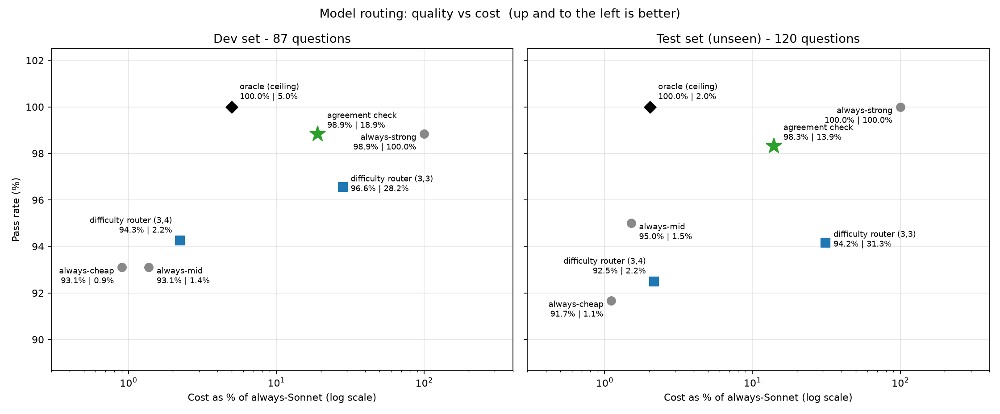

# Cost-aware model routing on Amazon Bedrock

When does it make sense to pay for a big model? This project measures how much quality you give up, and how much money you save, when questions are routed between three Amazon Bedrock models instead of always using the strongest one.

**Headline result (120 unseen test questions):** an *agreement check* - ask two cheap models, and escalate to Claude Sonnet 4.5 only when they disagree - answered **98.3%** correctly at **13.9% of the cost** of always using Sonnet (always-Sonnet scored 100%). That is roughly $0.22 per 1,000 questions against $1.55.



## Setup

| Tier | Model | Role |
|---|---|---|
| cheap | Amazon Nova Micro | first-pass answerer |
| mid | Amazon Nova Lite | second opinion / mid-tier |
| strong | Claude Sonnet 4.5 | expensive fallback |

All calls use the Bedrock Converse API in `us-east-1` with `temperature=0`. Cost is computed from token counts and the price table in `prices.json`.

### Routers compared

- **always-cheap / always-mid / always-strong** - the simple baselines.
- **oracle (ceiling)** - not a real router: for each question it picks the cheapest model that got it right, using results already saved. It shows the best any router could do.
- **difficulty router (T1,T2)** - a small model (Nova Lite) rates each request 1-5 *before* any answer exists. Difficulty up to T1 goes to cheap, up to T2 to mid, above T2 to strong. Classifier cost is included in the totals.
- **agreement check** - every question goes to cheap and mid. If their answers match, accept. If not, at least one is wrong, so escalate to strong. Works for exact-match answers (a letter or a number).

## Data and method

- **Public benchmarks (exact-match scoring):** ARC-Easy, ARC-Challenge (multiple choice) and GSM8K (grade-school math), downloaded with `src/prepare_dataset.py` and sampled with fixed seeds.
  - **Dev set** (`public_questions`): 30 + 30 + 30 questions, seed 42. Used to design and tune the routers.
  - **Test set** (`public_test`): 20 + 40 + 60 questions, seed 7, sharing no question with dev. Evaluated once, at the end, with settings fixed in advance.
- **BrightCart domain set (18 questions):** a fictional store's support questions with policy text in the prompt, scored 1-5 by an LLM judge against reference answers or rubrics. Used for exploration only; there is no held-out domain test.
- **A question "passes"** when the score is at least 4 (exact-match questions score 5 or 1).
- **Hand-checked exclusions** (`data/excluded.json`): two dev questions (ARCC04: questionable key; GSM27: ambiguous wording) are dropped for every tier. One dev question (GSM02) was blocked by Bedrock's content filter on both Nova models and is excluded for all tiers so every tier is compared on the same questions.

## Results

**Test set - 120 unseen questions**

| Setup | Pass rate | Cost vs always-Sonnet |
|---|---|---|
| always-cheap | 91.7% | 1.1% |
| always-mid | 95.0% | 1.5% |
| always-strong | 100% | 100% |
| oracle (ceiling) | 100% | 2.0% |
| difficulty router (3,4) | 92.5% | 2.2% |
| difficulty router (3,3) | 94.2% | 31.3% |
| **agreement check** | **98.3%** | **13.9%** |

**Dev set - 87 questions**

| Setup | Pass rate | Cost vs always-Sonnet |
|---|---|---|
| always-cheap | 93.1% | 0.9% |
| always-mid | 93.1% | 1.4% |
| always-strong | 98.9% | 100% |
| oracle (ceiling) | 100% | 5.0% |
| difficulty router (3,4) | 94.3% | 2.2% |
| difficulty router (3,3) | 96.6% | 28.2% |
| agreement check | 98.9% | 18.9% |

## What I learned

1. **The agreement check generalized(it works on both new questions and the ones we built it on).** It scored 98.9% on dev and 98.3% on the unseen test set, at 19% and 14% of Sonnet's cost. When the two cheap models agreed they were right 108 of 110 times on test; Sonnet fixed all 10 disagreements.
2. **The difficulty router did not hold up on new questions.** A small model (Nova Lite) rates each question 1 to 5, and the router sends hard-rated questions to a stronger model. On the dev set this scored slightly higher than always-cheap or always-mid (94.3% against 93.1% for the (3,4) setting). On the unseen test set it did worse than always-mid, which was cheaper and scored 95.0%. The gain on dev was probably luck: the cheap model got only 9 dev questions wrong, which is too few to tune a router on. There is also a second reason. Many of the cheap model’s failures were questions that look easy but need a fact the model doesn’t know, and a difficulty rating can’t detect that from the question alone.
3. **The agreement check has a blind spot.** If both cheap models give the same wrong answer, nothing escalates. This never happened on dev but happened twice on test (ARCC05, ARCC14) and accounts for both misses.

## Limitations

- The agreement check only applies to exact-match answers. It does not cover free-text domain questions.
- ARC and GSM8K are public and widely used, so the models may have seen them during training; real traffic would be messier.
- With 120 test questions, 98.3% (118 correct) has a wide uncertainty range (roughly 94% to 99.5%), and always-mid's 95.0% range overlaps it. The result is promising, not proven.
- Test-set answer keys were not hand-checked. Sonnet scored 100%, so any key error would have to match Sonnet's answer.
- The BrightCart judge is Sonnet, which is also the strong tier, so it may favor its own style.
- An escalated request waits for two cheap models and then Sonnet, so it is slower than calling Sonnet directly.


## Reproduce it

```bash
pip install -r requirements.txt
cp .env.example .env          # add AWS credentials and the three model IDs
python src/models.py          # checkpoint: one call per tier

python src/prepare_dataset.py
python src/prepare_dataset.py --out data/public_test.jsonl --seed 7 --n-easy 20 --n-challenge 40 --n-gsm 60 --exclude data/public_questions.jsonl

# baselines (repeat for --tier mid and --tier strong)
python src/run_eval.py --tier cheap --questions data/public_questions.jsonl
python src/run_eval.py --tier cheap --questions data/public_test.jsonl
python src/run_eval.py --tier cheap                      # BrightCart set

python src/classify.py public_questions                  # difficulty ratings
python src/classify.py public_test
python src/analyze.py public_questions
python src/sweep.py public_questions pilot_questions     # tune thresholds on dev only
python src/agreement.py public_questions
python src/agreement.py public_test                      # final, one-time test evaluation
python src/make_chart.py
```

## Repository layout

```
src/models.py            call any tier, return text/tokens/latency/cost
src/judge.py             LLM-as-judge scoring for free-text answers
src/run_eval.py          run one tier over a question set, score, save results
src/rescore.py           re-score saved answers after fixing answer extraction
src/prepare_dataset.py   download and sample ARC / GSM8K (dev/test split)
src/classify.py          difficulty rater for the difficulty router
src/sweep.py             evaluate difficulty thresholds from saved results
src/agreement.py         agreement-check router analysis
src/analyze.py           baselines and oracle
src/inspect_failures.py  read raw answers that several tiers got wrong
src/make_chart.py        cost-vs-quality chart and summary table
data/                    BrightCart questions, policies, hand-checked exclusions
```


